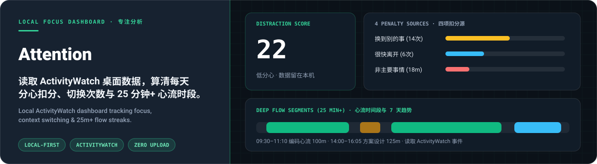
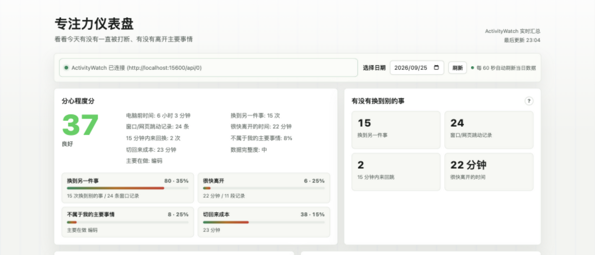
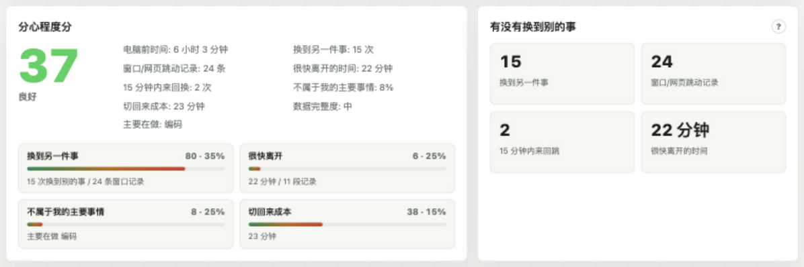
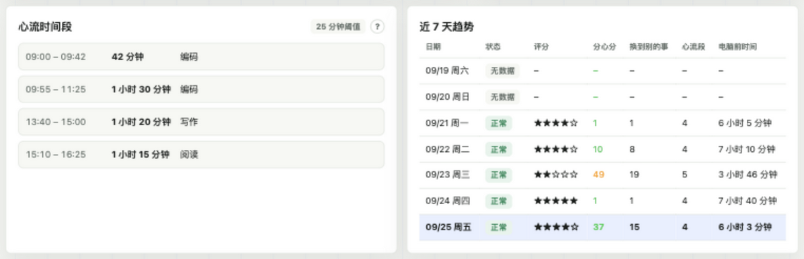
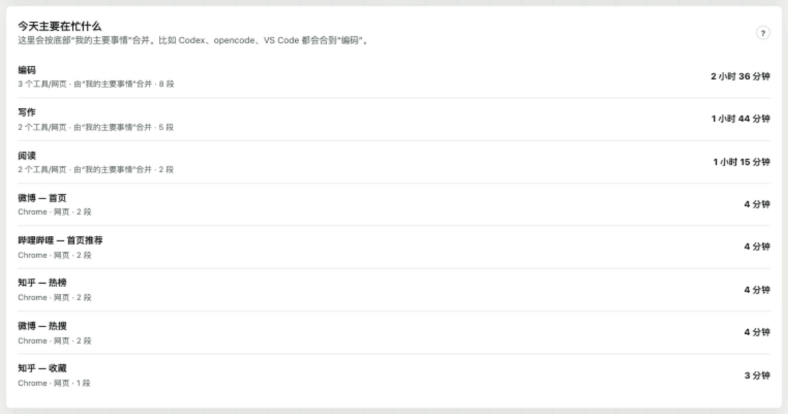
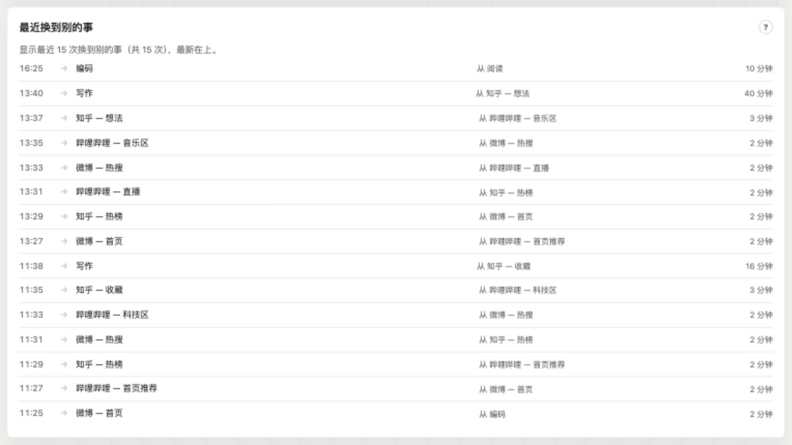
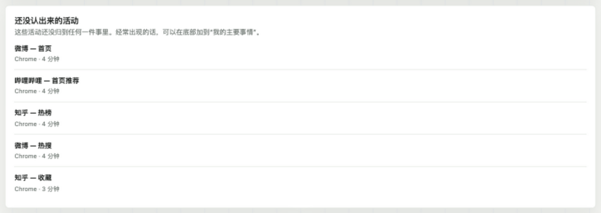
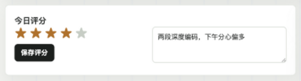
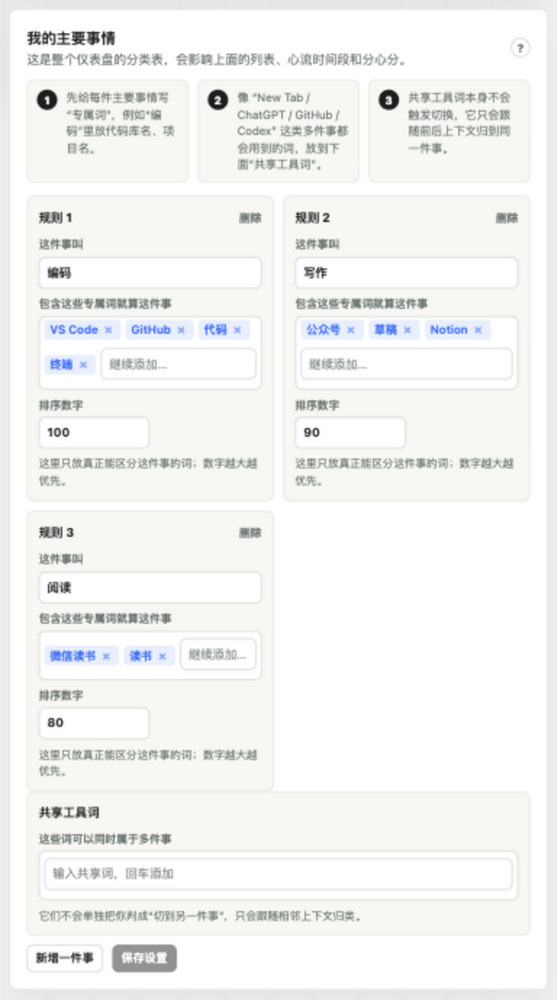
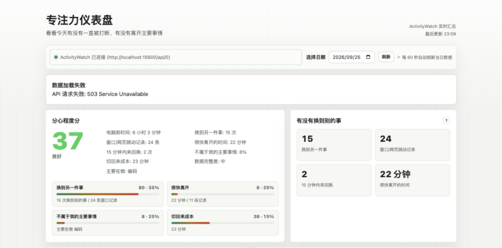

# Attention｜ActivityWatch 仪表盘与本地专注力分析

<!-- discovery:start -->
## ActivityWatch 本地专注力分析与任务切换仪表盘

**ActivityWatch 记录了电脑活动，怎么看一天的任务切换与专注时间？** 读取本机活动记录，按你定义的主要任务分类，展示切换计数、分心来源、持续专注时段与近 7 天趋势。

Local ActivityWatch focus analytics and context-switching dashboard.

**30 秒核心结论：** 直连本地 ActivityWatch（5600 端口） · 分析任务切换与近 7 天专注趋势 · 100% 本地运行 0 上传 · MIT 开源 0 元 · 更新于 2026-11-21。

**一键运行 / 收藏：** `git clone https://github.com/ouxxyy/Attention.git && cd Attention && npm install && npm run dev` ｜ `gh api -X PUT /user/starred/ouxxyy/Attention`

**开始使用：** [运行 ActivityWatch 与仪表盘](#quick-start) · [分类设置示例](#quick-example)。

**使用边界：** 需先运行 ActivityWatch 并配置分类规则；行为分数不是心理或医学诊断。

[按任务浏览欧八同学的全部工具](https://github.com/ouxxyy/ouba-classmate#按需求找)；如果本项目有帮助，欢迎收藏当前仓库。
<!-- discovery:end -->

<!-- hero:start -->

<p>
  <a href="https://github.com/ouxxyy/ouba-classmate"></a>
</p>

**直接读取本机 ActivityWatch 桌面活动记录，无需上传云端，每日生成分心指数扣分拆解、心流时间段追踪与近 7 天专注趋势分析。**  
<sub>Local ActivityWatch analytics dashboard quantifying context-switching penalties, deep-flow intervals, and 7-day focus trends with full privacy.</sub>

<p>
  <a href="https://github.com/ouxxyy/ouba-classmate"></a>
  <a href="#quick-example"></a>
  <a href="#quick-start"></a>
  <a href="#english-overview"></a>
  <a href="https://github.com/ouxxyy"></a>
</p>

> 🌟 本项目是 [欧八同学旗舰合集 `ouba-classmate`](https://github.com/ouxxyy/ouba-classmate) 的核心组件（11 个原创项目，可[一键安装全部 Skills](https://github.com/ouxxyy/ouba-classmate#install)）。如果它帮到了你，欢迎顺手给 [旗舰主仓库](https://github.com/ouxxyy/ouba-classmate) 点个 Star ⭐ 支持持续更新 ｜ 终端 1 秒加星：`gh api -X PUT /user/starred/ouxxyy/ouba-classmate`


<!-- hero:end -->

盯着电脑工作了一天，却说不清时间都花在哪、被打断了几次？Attention 读取 [ActivityWatch](https://activitywatch.net/) 的桌面行为数据，每天给你一份说得清的答案：换到别的事几次、哪些时段真正连续专注、有多少时间花在主要事情之外。数据全部留在本机，不上传任何服务器。



左边是当天的分心程度分和四个扣分来源，右边是切换次数的原始计数；下面直接列出检测到的心流时间段和近 7 天趋势。

> [!TIP]
> 🎁 扫码关注公众号「欧八同学」，免费领取 AI 案例与 Skill《大厂产品AI经验编程 200 套》→ [去扫码](#author)

[使用示例](#quick-example) · [开始使用](#quick-start) · [English](#english-overview)

<a id="quick-example"></a>

## 一次使用示例

**设置示例：** 在「我的主要事情」中建立“编码”，把编辑器和相关文档归入同一件事，再查看当天报告。

**输出：** 不同工具可以合并为一项任务，报告列出换到别的事的次数、持续专注时段和近 7 天趋势。具体数值来自你的 ActivityWatch 记录，这里不预设专注成绩。

[启动仪表盘](#quick-start) 前需先运行 ActivityWatch。上方截图和下方 [效果一览](#效果一览) 展示了报告结构。

## 它会怎么做

1. ActivityWatch 在后台记录窗口标题、浏览器标签页和离开电脑的时间。
2. 仪表盘把这些原始事件整理成一段段时间线，去掉抖动和重叠。
3. 你在「我的主要事情」里定义几件事（比如编码、写作、阅读）和各自的关键词，同类工具自动归到同一件事。
4. 页面给出当天报告：分心程度分、心流时间段、主要任务分布、最近切换记录，以及可打分的今日评分。
5. 数据和配置都存在本地 `data/` 目录，纯本机运行。

## 效果一览

**分心从哪来** —— 四个子分分别对应「换到别的事」「很快离开」「不属于主要事情」「切回来成本」，每个都能展开看到原始计数。



**心流时间段** —— 同一件事连续累计 25 分钟以上就会标记出来，中间 2 分钟以内的小插曲可以容忍；近 7 天趋势直接对比每天的专注状况。



**时间花在哪** —— 按你定义的「主要事情」合并同类工具后排序，浏览器的走神记录也会单独列出来。



**切换记录** —— 每次从一件事跳到另一件事都有时间戳和来源，分心爆发一眼可见。



**没认出来的活动** —— 命中不了任何规则的活动会集中在这里，提醒你补一条规则。



**每日主观评分** —— 给当天打分并留一句话备注，趋势表里直接以星星展示，和客观数据放在一起回看。



<a id="quick-start"></a>

## 快速开始

前置条件：

- Node >= 18
- [ActivityWatch](https://activitywatch.net/) 已在本机运行（默认 `http://localhost:5600`），且至少有 `currentwindow` 和 `afkstatus` 两类 watcher；装了浏览器扩展（`web.tab.current`）后网页数据会更完整

```bash
npm install
npm run dev
```

打开 `http://localhost:5173` 即可。`npm run dev` 会同时启动后端（端口 8787）和前端开发服务器。

第一次使用先到页面底部「我的主要事情」里配置几件事和关键词——分类是所有指标的基础，这一步做完报告才有意义。



## 数据与隐私

- 全部数据留在本机：行为数据在 ActivityWatch 里，配置和评分在本仓库的 `data/` 目录（已加入 `.gitignore`，不会提交）。
- 没有账号、没有云端、没有遥测。
- 界面跟随系统浅色/深色模式。

## 故障排除

ActivityWatch 没启动时，页面顶部会出现明确的错误提示，修复后点「刷新」即可：



| 现象 | 检查项 |
|------|--------|
| 顶部提示数据加载失败 | 确认 ActivityWatch 已启动，访问 http://localhost:5600/api/0/info 应返回 JSON |
| 当天数据为空 | 确认 ActivityWatch 的 window/afk watcher 正在录制 |
| 数据完整度低 | 浏览器扩展没装或没生效，只有窗口标题可用 |
| 分心程度分为 0 | 当天活跃时间不足或没有切换行为，属正常 |
| 端口被占用 | 后端默认 8787，前端默认 5173 |

## 指标口径（参考）

<details>
<summary>分心程度分（0-100，越低越好）</summary>

```
energyWasteScore = round(
  0.35 × frequentSwitchScore +
  0.25 × shortStayScore +
  0.25 × deviationScore +
  0.15 × recoveryScore
)
```

| 子分 | 口径 |
|------|------|
| frequentSwitchScore | min(100, 频繁切换窗口数 × 25 + 换到另一件事次数 × 2) |
| shortStayScore | 很快离开的时间占比（片段 ≤ 2 分钟记为短停留） |
| deviationScore | 不属于任何「主要事情」的时间占比 |
| recoveryScore | min(100, 换到另一件事次数 × 1.5 分钟 ÷ 60) |

「换到另一件事」先按主要事情聚合：Codex、opencode、VS Code 都命中「编码」时，它们之间来回切仍算同一件事；任一侧不足 15 秒的小抖动不计入。

</details>

<details>
<summary>心流时间段判定</summary>

同一件「主要事情」下，活跃时长 ≥ 25 分钟（`flowMinMinutes`）的连续时段；容忍的打断次数 ≤ floor(活跃时长 ÷ 25)；单次打断 ≤ 2 分钟且之后回到同一件事；离开电脑超过 3 分钟（`afkGraceMinutes`）重新计算。

</details>

<details>
<summary>默认阈值与数据假设</summary>

```json
{
  "flowMinMinutes": 25,
  "shortSwitchMaxMinutes": 2,
  "frequentSwitchWindowMinutes": 15,
  "frequentSwitchCount": 6,
  "afkGraceMinutes": 3
}
```

可在 `data/config.json` 或页面里修改。心跳事件（duration=0）向后推断至下一个事件、最长 120 秒；网页事件与窗口事件重叠 ≥ 50% 时以网页为准；相邻同任务片段间隔 ≤ 60 秒自动合并。完整算法见 [docs/AGGREGATION_ALGORITHM.md](docs/AGGREGATION_ALGORITHM.md)。

</details>

## API（开发者）

| 方法 | 路径 | 说明 |
|------|------|------|
| GET | `/api/health` | ActivityWatch 连接状态 + bucket 列表 |
| GET | `/api/summary?date=YYYY-MM-DD` | 当天汇总（指标 + 心流段 + 时间线） |
| GET | `/api/trends?days=N&end=YYYY-MM-DD` | 多日趋势（默认 7 天） |
| GET | `/api/events?date=YYYY-MM-DD` | 当天原始事件 |
| GET / PUT | `/api/config` | 读取 / 更新配置（写入经 schema 校验） |
| GET | `/api/ratings` | 全部每日评分 |
| PUT | `/api/ratings/:date` | 写入某日评分（1-5 分 + 备注） |

配置与评分存放在 `data/`：`config.json`（阈值、关键词规则、通知）、`ratings.json`（每日评分）。两者都有 schema 校验，非法写入返回 400 和具体原因。参考 `data/config.example.json` 与 `data/ratings.example.json`。

## 测试

```bash
npm run test:run
```

覆盖事件归一化、指标计算和 schema 校验，位于 `shared/__tests__/`。

## 常见问题

### 需要先安装 ActivityWatch 吗？

需要。仪表盘读取已有 ActivityWatch 数据，至少需要窗口与离开状态 watcher；浏览器扩展能提供更完整的网页记录。

### 为什么第一次打开分类不准确？

先配置「我的主要事情」及关键词。任务分类是切换、分心与专注统计的基础。

### 会上传窗口标题或浏览记录吗？

项目在本机读取数据，配置和评分也保存在本机；没有账号、云端或遥测。

### 分心程度分是医学或心理诊断吗？

不是。它是按公开口径整理的行为统计，用于回顾时间分配，不用于诊断注意力障碍。

<a id="english-overview"></a>

## English overview

Attention is a local ActivityWatch dashboard for context switching, distraction patterns and sustained focus periods. It groups window and browser activity using your task rules, then shows daily counts and recent trends.

[Quick start](#quick-start) requires Node.js 18+ and an already running ActivityWatch instance. Configure your main tasks before interpreting the metrics. Activity and configuration stay on your computer; the custom metrics are not medical or psychological assessments.

<!-- suite-matrix:start -->

## 更多开源项目 · More from ouba-classmate Suite

> 如果这个项目帮到了你，欢迎去旗舰合集仓 [**`ouxxyy/ouba-classmate`**](https://github.com/ouxxyy/ouba-classmate) 点一颗 Star 或一行安装全部 Skills：
> `npx skills add ouxxyy/ouba-classmate` · `gh api -X PUT /user/starred/ouxxyy/ouba-classmate`

| 仓库 · Repo | 分类 · Category | 它做什么 · What it does |
| --- | --- | --- |
| [`ouba-classmate`](https://github.com/ouxxyy/ouba-classmate) | SUITE · 旗舰合集 | **11 个原创项目总仓 + 一键安装全部 Skills + 在线战力测算与防身情报库**<br><sub>All-in-one Skills suite & benchmark</sub> |
| [`jd-resume-match`](https://github.com/ouxxyy/jd-resume-match) | CAREER · 求职涨薪 | **AI 简历优化与 JD 匹配体检（确定性公式 + 行号证据）**<br><sub>Deterministic JD matching & line-cited resume audit</sub> |
| [`ai-interviewer`](https://github.com/ouxxyy/ai-interviewer) | CAREER · 求职涨薪 | **中文语音/文字原话追问 AI 模拟面试官（含在线版）**<br><sub>Chinese voice AI mock interviewer anchored to your answers</sub> |
| [`job-search`](https://github.com/ouxxyy/job-search) | CAREER · 求职涨薪 | **跨 5 平台实时去重筛岗，输出带来源短名单**<br><sub>5-platform source-backed job search & shortlist builder</sub> |
| [`sherlock-company`](https://github.com/ouxxyy/sherlock-company) | CAREER · 求职涨薪 | **入职前四态证据公司背调与 Offer 核实清单**<br><sub>Pre-offer employer research with 4-state evidence boundaries</sub> |
| [`mbai`](https://github.com/ouxxyy/mbai) | CAREER · 求职涨薪 | **工作任务 AI 不可替代指数与 4 核决策复盘**<br><sub>Task-level AI irreplaceability index & decision reflection</sub> |
| [`codex-gif-video`](https://github.com/ouxxyy/codex-gif-video) | CREATIVE · AI 创作 | **69 种风格原生 GIF 与静音 MP4 素材生成 Skill**<br><sub>Native GPT Image 2.6 animated GIF & MP4 generator (69 styles)</sub> |
| [`storyboard-scavenger`](https://github.com/ouxxyy/storyboard-scavenger) | CREATIVE · AI 创作 | **可灵/即梦/Veo/Sora 七要素 AI 视频分镜工作流**<br><sub>7-element AI video storyboard skill for Kling & Seedance</sub> |
| [`travel-art-album-skill`](https://github.com/ouxxyy/travel-art-album-skill) | CREATIVE · AI 创作 | **旅行照片艺术画册与单文件离线翻页相册 Skill**<br><sub>Art-styled travel photo proofs & standalone offline HTML flipbook</sub> |
| [`mystery-skill`](https://github.com/ouxxyy/mystery-skill) | COGNITION · 认知框架 | **Mystery 认知框架与职场心理博弈分析 Skill**<br><sub>Cognitive framework for interview frame & decision study</sub> |
| [`Attention`](https://github.com/ouxxyy/Attention) · **Current** | LOCAL APP · 本地工具 | **ActivityWatch 本地专注力、心流时段与切换分析**<br><sub>Local ActivityWatch focus & context-switching dashboard</sub> |
| [`postapp`](https://github.com/ouxxyy/postapp) | LOCAL APP · 本地工具 | **Chrome 本地摄像头姿态检测与坐姿提醒插件**<br><sub>On-device MoveNet Chrome posture reminder extension</sub> |

<!-- suite-matrix:end -->

<a id="author"></a>

## 作者

作者全平台同名：**欧八同学**。

- 个人主页 / 联系我：[albertou.redboook.cn](https://albertou.redboook.cn/)
- 微信公众号：扫码关注，免费领取 AI 案例与 Skill《大厂产品AI经验编程 200 套》
- 抖音：[搜索“欧八同学”](https://www.douyin.com/search/%E6%AC%A7%E5%85%AB%E5%90%8C%E5%AD%A6)
- 小红书：[搜索“欧八同学”](https://www.xiaohongshu.com/search_result?keyword=%E6%AC%A7%E5%85%AB%E5%90%8C%E5%AD%A6)
- X：[搜索“欧八同学”](https://x.com/search?q=%E6%AC%A7%E5%85%AB%E5%90%8C%E5%AD%A6&src=typed_query)

<p align="center">
  
</p>

<p align="center"><sub>扫码关注「欧八同学」，免费领取《大厂产品AI经验编程 200 套》</sub></p>

如果这个项目对你有用，欢迎点个 Star。遇到问题时，提交使用的命令、报错信息和最小复现步骤就够了。

## 许可证

[MIT](LICENSE)

<!-- footer:start -->

<p align="center">
  <a href="https://github.com/ouxxyy"></a>
</p>

<!-- footer:end -->
